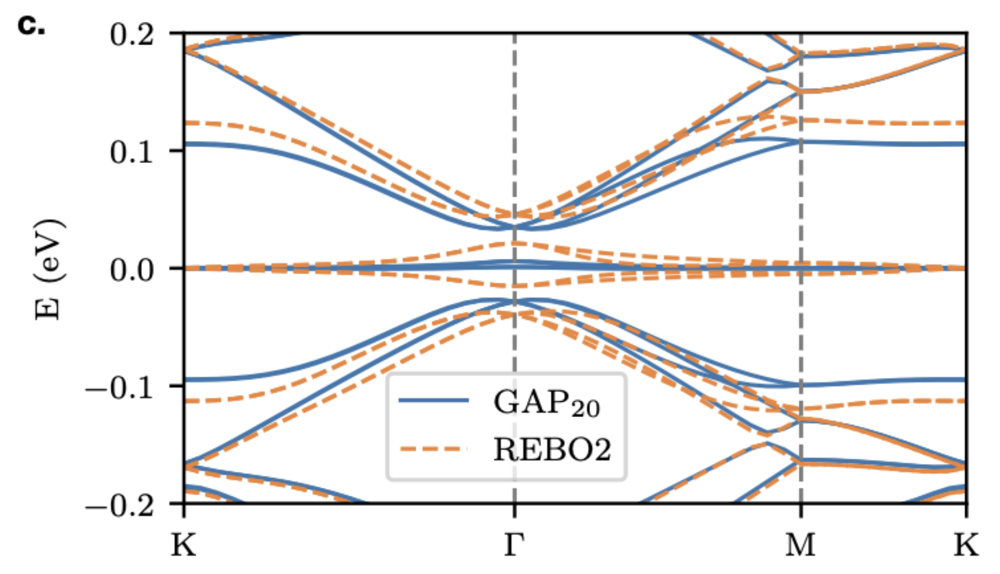
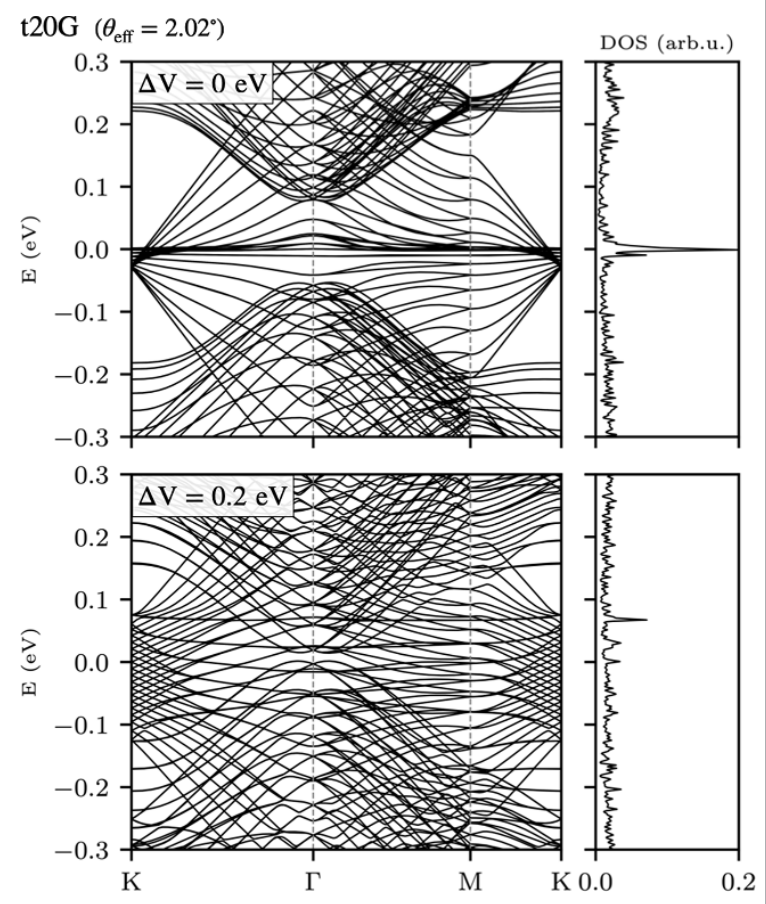
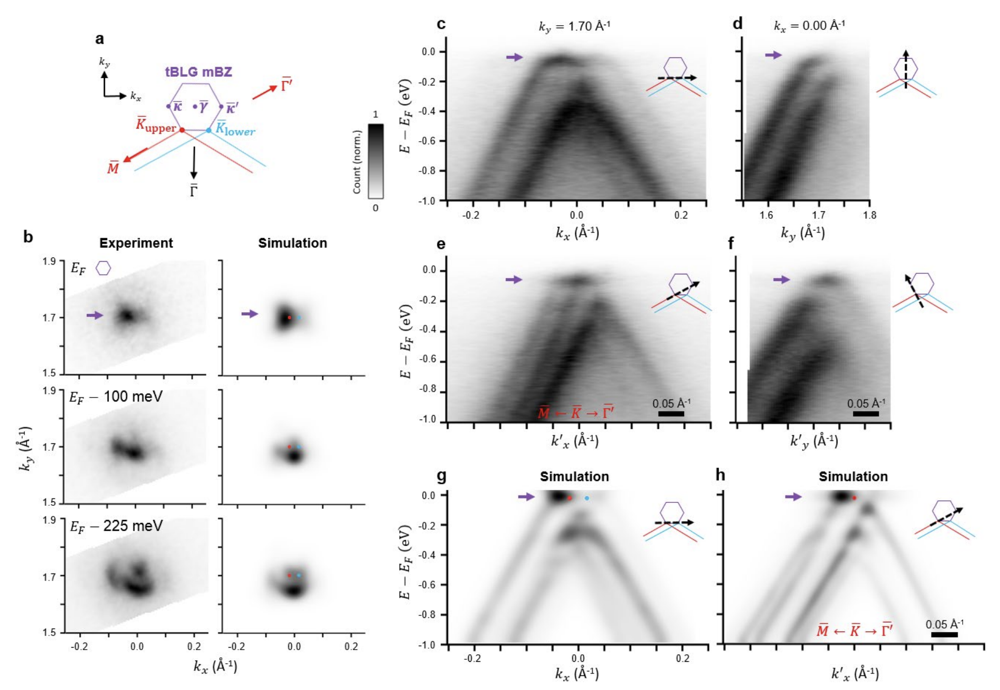

# Welcome to GRABNES

**GRABNES** (**GRA**phene/**B**N **E**lectronic **S**tructure) is a Fortran
tight-binding package for the electronic structure of layered two-dimensional
materials. The name highlights the two standard materials that can be studied
with this package by layering them into meaningful configurations. Additional
2D materials can be included as well by modifying the code.

Out of the box you can build graphene on hBN, twisted bilayer graphene,
twisted multilayer graphene, hBN-encapsulated single-layer graphene,
encapsulated bilayer graphene, and more, with full control over the twist
angle and the sliding between layers. Commensurate cells are built
automatically to account for periodic boundary conditions.

{button}`Get started <installation.md>`
{button}`Read the guide <guide.md>`
{button}`Browse the examples <examples/index.md>`
{button}`Source code <https://github.com/gjung-group/grabnes>`

## What you can compute

::::{grid} 1 2 2 2

:::{grid-item-card} Structures
:link: theory/moire-cells.md

Commensurate moiré supercells with controllable twist angle and interlayer
sliding, for graphene, hBN and their combinations. LAMMPS interface for
structural relaxation.
:::

:::{grid-item-card} Band structures & DOS
:link: theory/observables.md

Electronic band structures and density of states, using Lanczos recursion as
well as exact diagonalization — from a few atoms up to tens of millions.
:::

:::{grid-item-card} Spectral functions
:link: theory/observables.md

Unfolded spectral band structures for direct comparison with ARPES
experiments, local density of states, and probability densities from the
wavefunction distribution.
:::

:::{grid-item-card} Transport & magnetic field
:link: theory/observables.md

Kubo–Greenwood conductivity, Landau levels in a perpendicular magnetic field,
and the effect of Anderson disorder on the DOS.
:::

::::

```{important}
GRABNES has no numbered release yet. The [](examples/index.md) are tested on
every change and reproduce their reference data; other functionality is
research code of varying maturity. See [](status.md) for what is supported and
[](citing.md) for how to cite the code.
```

## Tight-binding models

Several of the tight-binding models used in this code have been developed by
researchers associated with this code. The [](theory/models.md) page presents
the general approach behind the so-called *hybrid* models, which leverage the
precision of accurate F2G2 models for the intralayer interactions and
reparametrized two-center (TC) models matched as closely as possible to DFT
for the interlayer interactions.

## Illustrations

### Magic angle renormalization in twisted bilayer graphene

We can calculate the electronic band structure of twisted bilayer graphene
using our SHE model, an improved two-center (TC) model optimized to capture
the DFT tunneling at the K-point while allowing the user to tune it to capture
the magic angle at a specific value. Here we set $S$ so that the magic angle
occurs at $1.08^\circ$ when using the relaxed structures from an energy
minimization with LAMMPS based on EXX-RPA-informed registry-dependent force
fields. The intralayer terms used in LAMMPS are either the widely used REBO2
force fields or the machine-learning based GAP20 potential.



### Twisted multilayer graphene band structures

A wide variety of layered materials can be considered in GRABNES. The
Hamiltonian part of the code supports a 20-layer twisted graphene system,
clearly showing the family of tBG bands expected in such tNG systems. A flag
in the GRABNES input file activates a perpendicular electric field.



### Twisted bilayer graphene: band unfolding

Our code calculates band-unfolded band structures that help interpret
experimental ARPES measurements. Here we observe good agreement between
experimental features obtained using nano-ARPES and simulated features
obtained with our package.



Comparison of experimental ARPES data with simulated band-unfolded data using
GRABNES. Figure published in
[Nature Physics](https://www.nature.com/articles/s41567-020-0974-x).

More results are collected in the [](benchmarks/index.md).

## Getting in touch

The documentation of the code internals is a work in progress. For specific
questions, open an issue on GitHub or email
[lecontenicolas@gmail.com](mailto:lecontenicolas@gmail.com).
